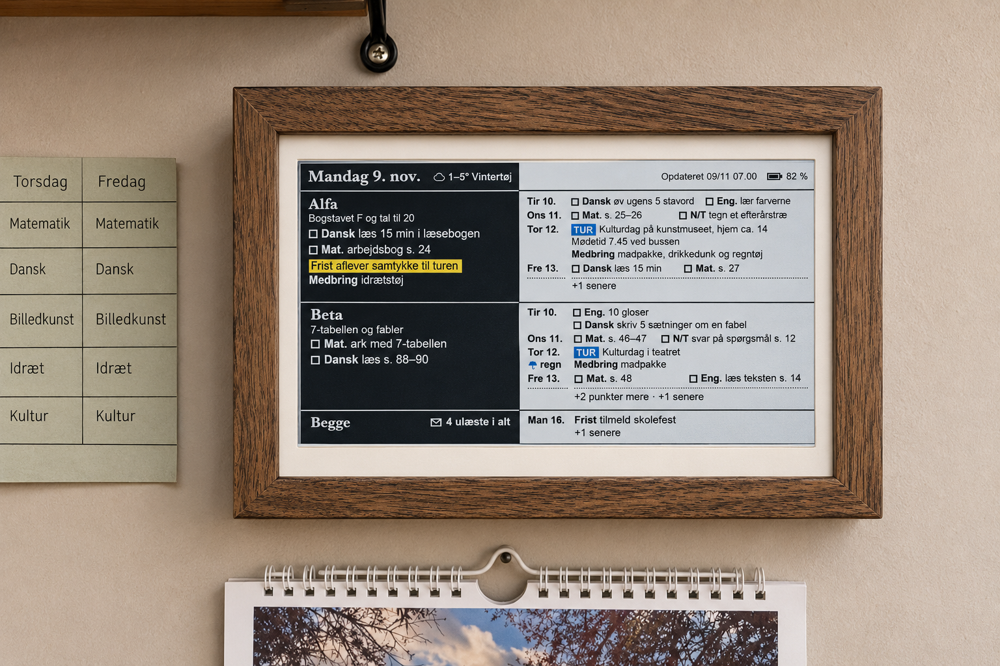
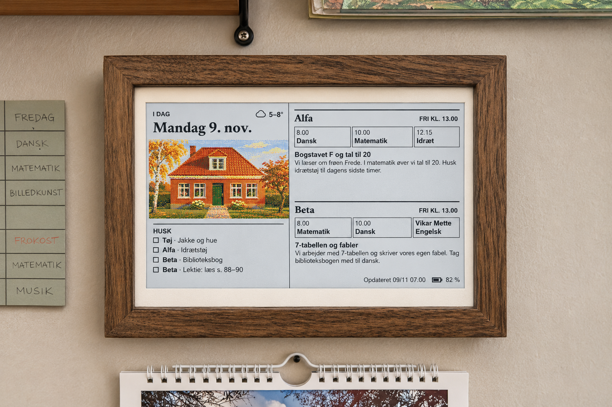
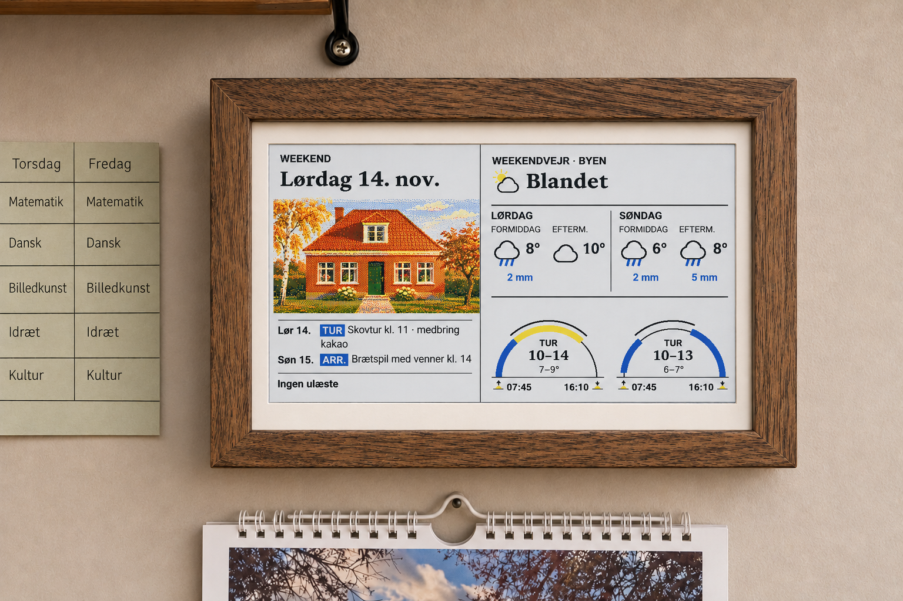
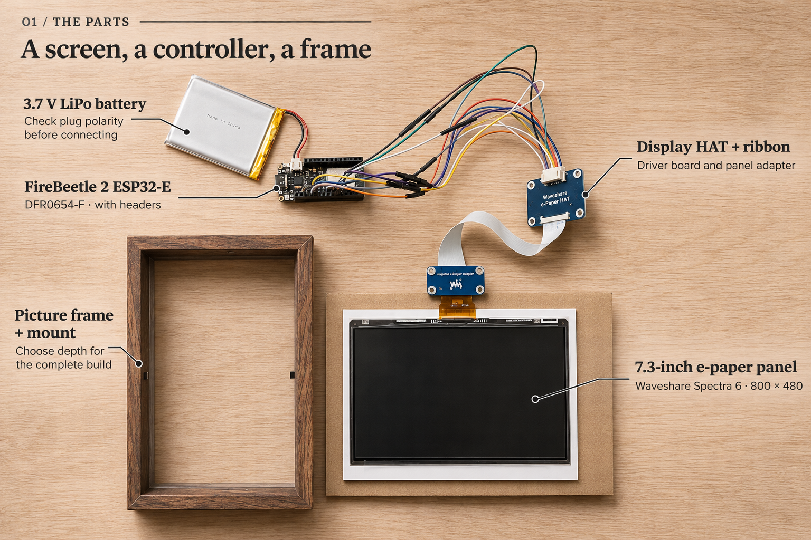

# Skolekit

**A calmer school week for the whole family.**

**Skolekit** is the umbrella project and its toolkit for live school access.
**Skoleklar** is the family app built on it: it aggregates school information
into a checked household plan, dashboards and reminders.

Homework in the weekly plan. A packing list in a teacher's message. A class
party in a parent conversation. A changed lesson in the timetable. Keeping up
means more than reading everything: you have to remember which child it concerns,
when it matters, and what someone needs to do.

Skoleklar brings those details into a family overview: what is happening,
what to prepare, and what needs attention next. Start with Skolekit's local CLI
and MCP tools, add Skoleklar for a checked school week, or put its shared
dashboard on the wall where the family can see it.



*An illustrated home setup based on the author's installation, with invented
family details. [See the parents' screen at full size](imgs/readme/parents-board.png).*

The project is self-hosted and currently connects to SkoleIntra. Use Skolekit
on its own for live school lookups, or add Skoleklar for the family planner,
browser dashboard and optional DIY e-ink display.

## Less to keep in your head

School communication arrives a piece at a time. Parents need to turn it into a
plan for the household. Skoleklar helps with that daily work:

- **Know what to do tonight.** See each child's homework, things to bring,
  deadlines and next school day together, instead of piecing them together
  across plans, notices and calendars.
- **Catch the details inside conversations.** With message processing enabled,
  school and parent conversations in SkoleIntra can contribute event dates and
  bring-items to the overview, including class parties and trips.
- **Prepare before the morning rush.** Check clothing for the weather, the
  packing list, lessons and finishing times before anyone heads out.
- **See beyond tomorrow.** Look ahead to trips, meetings, class events and
  deadlines, with a row for each child and a shared row for both.
- **Share the remembering.** Give parents and children a common place to check
  the day, on the browser dashboard or the shared e-ink board.
- **Let the weekend feel like the weekend.** Switch from homework to family
  activities, weather and a suggested dry window for a trip outside.
- **Check where a detail came from.** The stored school week keeps the source
  of its facts; uncertain items and older data are flagged for attention.

Messages are opt-in. A clean installation does not read the inbox during scans.
Enabled processing extracts a limited set of event facts; it does not keep a
copy of the conversations. Message-derived times require a live source check,
and attachment text is not extracted. See [message privacy](docs/message-harvesting.md)
for the choices and boundaries.

## A dashboard for parents, a day view for children

Skoleklar's **parents' board** puts the next school day on the left and the days ahead
on the right. Homework has checkboxes, events have category labels, and urgent
deadlines or changed times get a yellow highlight. Each child has their own row,
so you can see who needs what without mixing their weeks together.

The **children's view** answers the questions that matter before school:
*What are my lessons? When do I finish? What should I bring?* A short retelling
of the day's plan adds context, and the **Husk** list brings clothing, packing
and homework reminders together.



*The children's day view, with invented school data and the display's six-colour
palette. [See the children's screen at full size](imgs/readme/kids-board.png).*

The board switches views with the family day: children see today's lessons
before school and the next school day in the afternoon; parents get the wider
overview in the evening. The browser and e-ink versions use the same prepared
dashboard state, including the weekend mode below.

A framed e-ink board fits beside the paper timetable and calendar. Everyone
can glance at it without opening an app or borrowing a parent's phone. It keeps
its picture while the device sleeps, then wakes to download and draw the next
prepared frame.

Read more about the [parents' board](docs/parents-board.md),
[children's day view](docs/day-view.md), [weekend cover](docs/weekend-artwork.md)
and [automatic view changes](docs/dashboard-timeline.md).

## A weekend view with room for family life

The board can take a break from homework too. With weather configured, Skoleklar
switches to a **weekend mode focused on family activities and time outdoors**
from Friday afternoon until Sunday noon. The lesson and homework layout gives
way to weekend plans, seasonal house artwork and a two-day weather overview.
On Sunday afternoon, school preparation returns for the coming week.

The forecast suggests a **trip window**: a dry stretch within daylight hours,
shown on each day's sunrise-to-sunset arc. It looks for four hours first, then
three or two, favouring sunshine, warmth and calmer wind. If there is no dry
window, the board says so. A short weather verdict helps the family decide
whether it is a day for being outside, a forest walk or an indoor outing.



*An illustrative home scene using synthetic plans and forecasts. Saturday's
suggested trip window is **10–14**, alongside a forest walk and a Sunday board-game
afternoon. [See the weekend screen at full size](imgs/readme/weekend-board.png).*

Weather is optional; configure your place in `skoleklar.toml` to enable this
view. See the [weather setup](infra/gcp/README.md#first-setup),
[weekend artwork](docs/weekend-artwork.md) and
[view timing](docs/dashboard-timeline.md).

## Start local. Grow into a family dashboard.

Start with Skolekit for live school access. Skoleklar builds on it to aggregate
and interpret information across the household, then deliver it to the browser
or wall display, with an optional phone manifest. Choose the level that fits
your family:

| Level | What you get | Why it helps |
| --- | --- | --- |
| **1 · Skolekit: local toolkit** | `skolekit` CLI and MCP server for live lessons, calendars, plans, forms, notices and requested message reads | Look up school information from your terminal or through an assistant, without a school-record database or model |
| **2 · Skoleklar: family planner** | `skoleklar` scans, checked household records, school-week CLI and stored-record MCP server | Bring each child's week together, trace facts to their sources and ask questions across the household |
| **3 · Skoleklar: dashboard and phone manifest** | A browser board with optional GCP hosting and an optional iPhone Shortcut for shared Calendar and Reminders | Share the family overview in the browser and sync checked events and reminders to the phone |
| **4 · Skoleklar: e-ink in the home** | An 800×480 six-colour Waveshare Spectra 6 display with a FireBeetle ESP32-E | Put the school day in a shared physical place, with automatic views for parents, children and weekends |

The first two levels run locally on macOS or Linux. The browser board can also
run locally; remote access and the e-ink device use the documented GCP setup.
Cloud provisioning, iPhone and hardware helpers currently need a Mac. The
e-ink option is a build-it-yourself device; no enclosure design is supplied.

Both Python packages currently ship in the `skoleklar` distribution. The
`skolekit` package and command handle live school reads; `skoleklar` adds the
household database, aggregation, interpretation and delivery. Each has its own
MCP server, so an assistant can use live lookups or the aggregated family view.
For the technical design, see [architecture](docs/architecture.md).

**Phone setup:** A scan publishes a v2 phone manifest. With **Refresh School**
installed on the primary iPhone, the Shortcut applies calendar and reminder
entries to the shared iCloud destinations and sends reminder completions back.
See the [iPhone guide](docs/iphone-refresh-school.md) for setup and device checks.

## Technology stack

| Layer | Technologies |
| --- | --- |
| Core & tooling | [](https://www.python.org/) [](https://sqlite.org/) [](https://docs.astral.sh/uv/) [](https://hatch.pypa.io/) [](https://docs.pytest.org/) |
| School access | [](https://www.python-httpx.org/) [](https://www.crummy.com/software/BeautifulSoup/bs4/doc/) [](https://python-jsonschema.readthedocs.io/) [](https://keyring.readthedocs.io/) [](https://playwright.dev/python/) [](https://www.chromium.org/) |
| APIs & interpretation | [](https://fastapi.tiangolo.com/) [](https://www.uvicorn.org/) [](https://modelcontextprotocol.io/) [](https://openrouter.ai/) [](https://open-meteo.com/) |
| Dashboard & phone | [](https://developer.mozilla.org/en-US/docs/Web/HTML) [](https://developer.mozilla.org/en-US/docs/Web/CSS) [](https://developer.mozilla.org/en-US/docs/Web/JavaScript) [](https://pillow.readthedocs.io/) [](https://support.apple.com/guide/shortcuts/welcome/ios) [](docs/iphone-refresh-school.md) |
| Cloud · optional | [](https://www.docker.com/) [](infra/gcp/README.md) [](infra/gcp/README.md) |
| E-ink · optional | [](firmware/README.md) [](https://docs.arduino.cc/arduino-cli/) [](firmware/README.md) [](docs/board-build-guide.md) |

## Build your own

The optional wall board brings together a **Waveshare 7.3-inch Spectra 6
display**, a **FireBeetle 2 ESP32-E with headers**, a **3.7 V LiPo battery** and
a frame of your choice. The display kit's HAT and ribbon connect the panel to
the controller; jumper leads complete the electrical build without soldering.



*Your own dashboard, inside a frame. A cleaned, AI-assisted illustration of the
author's parts; the [illustrated build guide](docs/board-build-guide.md) covers
the shopping list, assembly overview, wiring, tests and fitting the frame.*

Start with [local setup](docs/getting-started.md) for the application. It covers installation,
private configuration, login, model credentials and the first checked scan.
No school or household is bundled with the code. For the physical board, use
the [assembly overview](docs/board-build-guide.md#assembly-at-a-glance) and the
detailed device steps once the cloud service is ready.

```sh
uv sync --extra browser --extra board --extra server
uv run playwright install chromium
uv run skoleklar profile write --host SCHOOL.m.skoleintra.dk --child NAME:STUDENT_ID:CALENDAR_CLASS
uv run skoleklar login
```

Then set `[runtime] where = "local"` in the private `skoleklar.toml` file and
configure the model key as described in the setup guide:

```sh
uv run skoleklar scan
uv run skoleklar week
uv run skoleklar serve
```

The board is served on this machine at `http://localhost:8787/`. Keep exactly
one runtime as the database writer. Moving to GCP is an explicit setup step.

| Next step | Guide |
| --- | --- |
| Read the school's live pages or use the two MCP servers | [Local setup](docs/getting-started.md) |
| Run scheduled scans and access the board away from home | [Google Cloud setup](infra/gcp/README.md) and its [agent runbook](infra/gcp/SKILL.md) |
| Build the Waveshare Spectra 6 / FireBeetle ESP32-E board | [Parts, wiring, flashing and calibration](docs/board-build-guide.md) |
| Explore the currently unused phone manifest and iPhone integration | [Refresh School on iPhone](docs/iphone-refresh-school.md) |
| Understand or maintain the application | [Architecture](docs/architecture.md) and [maintenance guide](docs/maintenance.md) |

The [documentation index](docs/README.md) lists the maintained builder guides
and technical references.

## Installation choices

Python 3.12 or newer is required. The base installation is
`uv sync --no-dev`; add only the integrations you use:

| Extra | Adds |
| --- | --- |
| `browser` | Playwright for login and session renewal |
| `board` | Pillow for board rendering and artwork packaging |
| `server` | FastAPI and Uvicorn for the browser board and delivery API |
| `gcp` | Cloud Storage for cloud scans and database pulls |
| `mcp` | Local MCP servers |

For development, use `uv sync --all-extras` and follow the
[validation workflow](docs/maintenance.md#validation). Both Dockerfiles name
their runtime extras explicitly.

## Scope and limits

School HTTP access is enforced as read-only. There is no form submission,
message sending, read-status update, booking submission or school calendar edit.
School wording is configured over a Danish locale; the product's display text
and timing policy currently target Danish schools and Europe/Copenhagen.

The local board is loopback-only. Remote access uses the GCP deployment; LAN
serving with HTTPS and device authentication is not implemented. E-ink firmware
requires the documented FireBeetle ESP32-E, and updates use USB rather than OTA.
The iPhone workflow needs device acceptance testing on each installation.
[Known limitations](docs/maintenance.md#known-limitations) distinguish implemented
code from checks a builder must perform on their own cloud, phone and hardware.

Model interpretation can be wrong, and a failed scan can leave older data on
the board. Check the school's own site for anything that matters. Runtime and
model usage can incur charges; measure your own deployment rather than relying
on another household's usage history. Battery life also depends on the build
and must be measured on the assembled device.

## Licence

Free for noncommercial use under the
[PolyForm Noncommercial License 1.0.0](LICENSE.md). Commercial use needs a
separate licence from the author. The project is unofficial and is not
affiliated with SkoleIntra or any school. It is supplied without warranty;
see [NOTICE.md](NOTICE.md) for the required notice, responsibilities and
third-party licences.
