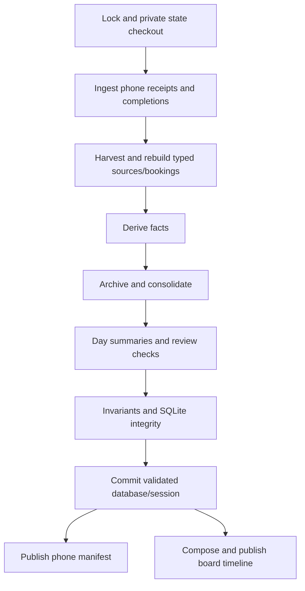

# Application architecture

For maintainers and agents changing the application. This is the current
ownership map, independent of any installation's deployment history.

## Packages and interfaces

| Owner | Responsibility | Must not do |
| --- | --- | --- |
| `skolekit` | School/profile configuration, authentication, read-only HTTP, parsers, bounded source adapters and per-child live services | Import `skoleklar`, keep a school-record database or call a model |
| `skoleklar` | Harvest policies, SQLite history, interpretations, household state, checked views, boards and delivery | Send school writes or store message text |

The project is one distribution with two import packages and two CLI entry
points. `skolekit` can be used without the product's optional integrations.
The old `agskoleintra` import package and `ag-school` CLI alias are absent.
Existing `ag-skoleintra` state paths, `AG_*` settings and `agskoleintra-*`
cloud resource names remain intentional compatibility names.

The CLI parser defines flags and imports handlers only after selection.
Service functions use request dataclasses and `StageResult`; the scan does
not construct argparse namespaces or recover values from printed JSON.
The stdio MCP servers call the same read services as their CLI equivalents.

## One scan, two runtimes

`runtime/scan.py` owns the shared scan. `runtime/local.py` and
`runtime/gcp.py` supply locking, private workspace checkout/commit, secrets,
output stores and run summaries.

Local checkout uses SQLite backup into a private temporary directory beside
the household database. Commit checks that the original database/session
fingerprints did not change, then replaces staged files. GCP downloads private
objects and commits with generation preconditions. These guard the database
against competing writers; separate objects are not one distributed transaction.
A scan also holds the runtime's lock.

Database validation and commit happen before independent output work. A board
or phone publication failure produces `partial`; it does not roll back the
validated database. A failed data stage stops before commit. Day-summary and
review failures are handled conservatively so a later scan can retry them.

## Configuration

| File | Owner and contents |
| --- | --- |
| `school.toml` | `skolekit`: HTTPS host, portal, locale, timezone, classes and school-wording overrides over `locales/da.toml` |
| `profile.toml` | `skolekit`: children, student IDs, URL names, class levels/codes and departments |
| `skoleklar.toml` | Product: `[meaning]` booking rules, `[runtime]` writer/model/scan times, optional `[weather]` and `[gcp]` |
| `triage.toml` | Product: optional `[slots]` used by prompt examples |

School and profile files are required. State directories and secret names are
configured centrally in `skolekit/state.py`; importing `skoleklar` selects the
product's state namespace. A scan uses a temporary state-directory override,
then restores the caller's scope. GCP downloads configuration and optional
private artwork but never writes those configuration files back.

One database belongs to one household at one school/login. Record identities
do not include a school host; combining schools into one database is unsupported.
See [source adapters](data-sources.md) and [data foundation](data-foundation.md).

## Checked reads and delivery

`week.week_view` exposes checked current facts, sanitized message facts and
bookings, with `as_of` from a completed harvest. The board and phone apply the
same stored review verdicts; their projections and date windows differ.
`trace` reads provenance separately. A board model composition is not a new
source of facts.

Pulled copies open with `mode=ro&immutable=1` per read, so replacing the copy
between MCP calls is visible on the next call. Rendering never migrates or
marks records delivered. Phone receipts are ingested by the next scan.
The delivery API does not need access to the school database or login session.

See [processing](processing.md), [board generation](board-generation.md),
[timeline](dashboard-timeline.md) and [delivery contracts](delivery.md).

## Privacy and extension boundaries

`ReadOnlyClient` restricts requests to the configured HTTPS school host and
known read methods/endpoints. Browser login is the separate authentication
path. Published pages may be retained as source records; messages use a
restricted transient path and never become message source records.
Model calls send school text to the configured provider through the enforced
ZDR route; this is not a promise that data stays in the cloud project's region.
See [message privacy](message-harvesting.md).

Runtime prompt bundles, migrations and API schemas are versioned contracts.
Keep their owning code and tests in step when extending them. Use
[maintenance](maintenance.md) for validation and release checks.
