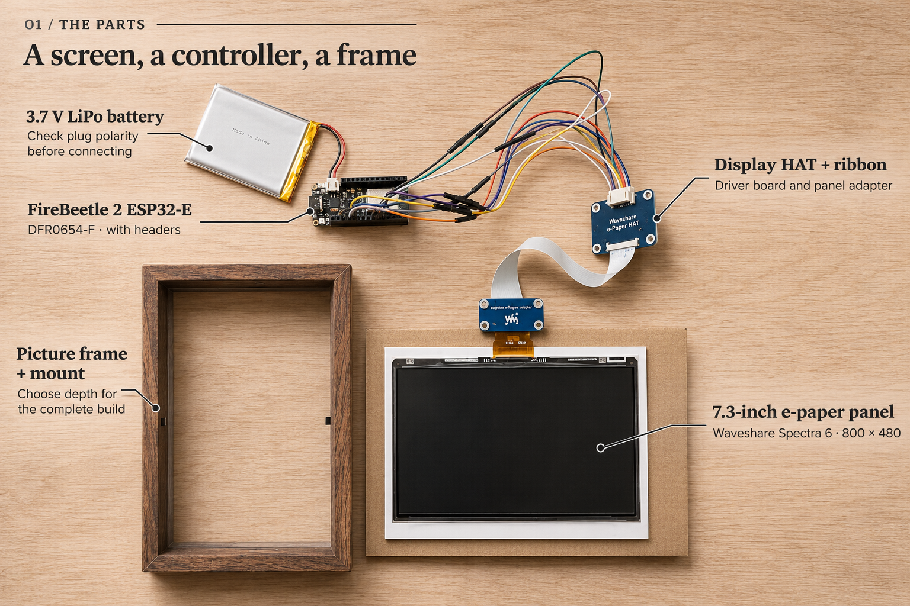
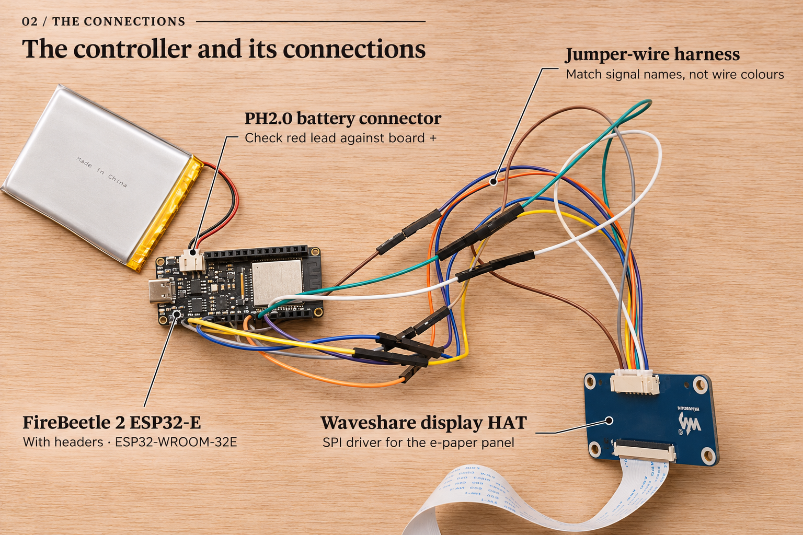
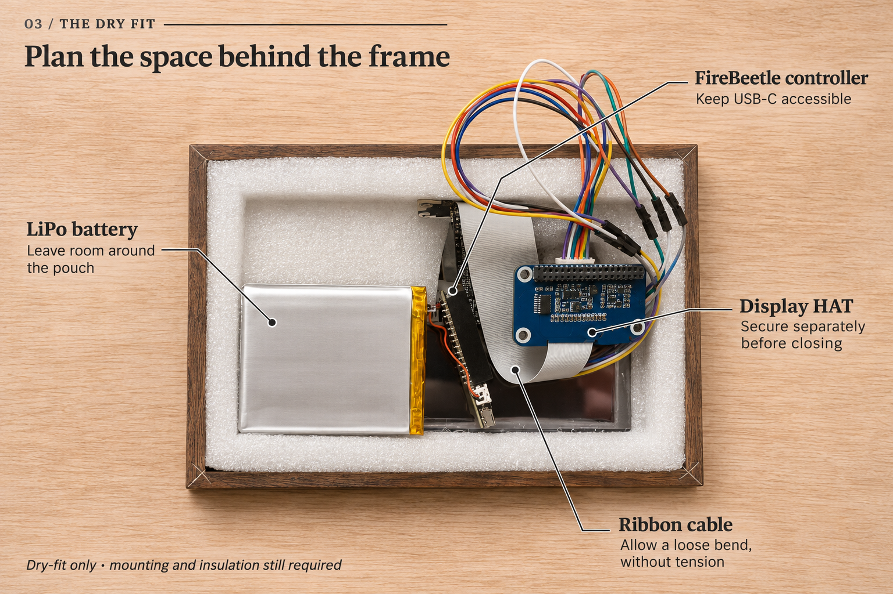
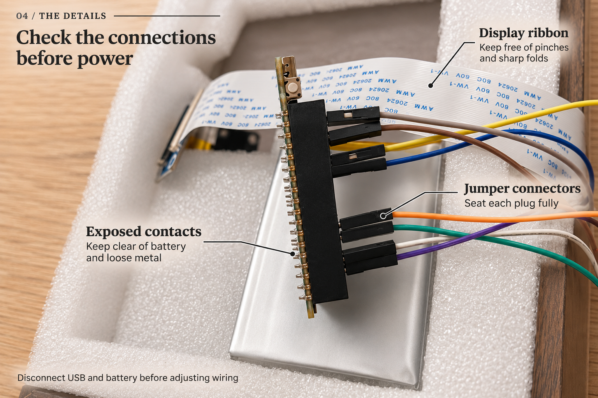

# Build your own e-ink board

This guide goes from a bag of parts to the six-colour e-ink board on the
kitchen counter: wired, flashed, linked to the household's cloud, and asleep
between changes. No soldering is needed for the header-equipped parts listed here.
This is a builder guide; validate your own power, networking and device behavior.



*The author's build, cleaned up and annotated with the built-in image generation
tool. The four images identify parts and assembly details; use the written
pin table for wiring. The rear layout is a dry-fit example, not a finished
enclosure design.*

The board shows what the cloud has drawn; it never reaches the school itself.
Each scan draws every frame for the next 36 hours. The board wakes, downloads
the frame it lacks, checks it, draws it, reports its status and goes back to
sleep. The [dashboard timeline](dashboard-timeline.md) has the whole cycle.

## Parts

| Part | Supported choice | Qty | Notes |
| --- | --- | :---: | --- |
| E-paper display kit | Waveshare 7.3-inch e-Paper HAT (E), Spectra 6 | 1 | 800×480, six colours. Buy the kit with its matching driver HAT, panel adapter and ribbon; the bare panel alone is not the complete build. |
| Controller | DFRobot FireBeetle 2 ESP32-E **with headers** ([DFR0654-F](https://wiki.dfrobot.com/dfr0654-f/)) | 1 | ESP32-WROOM-32E, 4 MB flash. Not the ESP32-C6 FireBeetle, whose pins and buttons differ. |
| Battery | 3.7 V protected LiPo with a PH2.0 plug; 3300 mAh is a reference capacity | 1 | Check the polarity before plugging it in: red on `+`. |
| Wires | Jumper wires compatible with the HAT harness and fitted FireBeetle headers | 8 | Nine if your HAT has a `PWR` pin. Choose mating ends for your actual kit; the photos show joined jumper leads. |
| Cable | USB-C, data-capable | 1 | For flashing, provisioning and charging. |
| Frame or enclosure | Picture frame with space behind the panel, or a purpose-built enclosure | 1 | Check panel size, ribbon exit and depth with the boards, plugs and battery in place. The wooden frame is an example, not a specified part. |
| Mount and backing | Mount board and a rigid backing sized for the chosen frame | As needed | Support the display without squeezing the glass or trapping its flex cable. |
| Board mounting and insulation | Nonconductive supports, suitable fixings and insulating barriers | As needed | Keep circuit boards fixed and exposed contacts away from the battery. These are part of your enclosure design. |

The **display HAT** is the larger blue driver board. The **panel adapter** is
the small blue board next to the display's orange flex tail. The broad white
**ribbon cable** joins those two boards; the coloured **jumper harness** joins
the HAT to the FireBeetle. These are separate connections, not interchangeable
cables. Check your kit's contents before ordering duplicates.

The photos do not establish the battery's capacity, protection circuit or plug
polarity. Select those from the battery specification and verify the plug on
your own parts. DFRobot documents the controller's
[PH2.0 battery port and board pin labels](https://wiki.dfrobot.com/dfr0654-f/).

**Tools:**

- a Mac, because the helper scripts use the macOS serial driver, the Keychain
  and the clipboard;
- a multimeter, to calibrate the battery reading.

For the frame, have a ruler and the tools required by your chosen backing and
fixings. A soldering iron is not needed for the header-equipped electrical build.

## Assembly at a glance

| Stage | What to do | Ready to continue when… |
| --- | --- | --- |
| Lay out the parts | Identify the panel, its adapter, ribbon, HAT, controller and battery. | The complete display chain is present. |
| Plan the frame | Dry-fit everything with USB and battery disconnected. Allow room for plugs and a loose ribbon bend. | The back can fit without pressing on the panel, battery or cables. |
| Test the controller | Follow [steps 1–2](#1-prepare-the-mac) with the FireBeetle alone on USB. | The smoke test answers `info`. |
| Connect and test the display | Follow [step 3](#3-wire-the-panel), then run the six-colour bands test. | All six bands draw on the loose, supported panel. |
| Link the cloud | Follow [steps 4–7](#4-register-the-board-with-the-cloud). | An authenticated sync draws a dashboard and the device page works. |
| Add battery power and mount | Follow [step 8](#8-battery-and-sleep), then [fit the tested build](#fit-the-tested-build-into-its-frame). | Timer wakes work on the cell and everything is fixed without pressure or exposed-contact shorts. |

Check the actual display outline and cable exit against the frame before
cutting a mount. Keep the panel supported while working. Its glass and flex
tail are fragile: avoid pressure, twists and sharp folds, as described in the
[Waveshare handling guidance](https://docs.waveshare.net/7.3inch_e-Paper_HAT_E/).
Leave the battery unplugged through the bare-board and panel tests.

## Before you start: the cloud side

The board talks to the cloud only through the household's API gateway. It
uses HTTPS, the gateway key and a display-only token of its own. So the
cloud needs two things first:

- the scan job, publishing frames (the `core` module);
- the delivery service behind the gateway (the `phone` module).

The [`ag-school-gcp`](../infra/gcp/SKILL.md) skill builds both: steps 1–13 of
its sequence. On the Mac, you need the repository with `uv sync --all-extras` done.

## 1. Prepare the Mac

**The serial driver.** The FireBeetle's USB port is a WCH CH340 serial bridge.
Install the [official WCH driver](https://github.com/WCHSoftGroup/ch34xser_macos),
then enable it under System Settings → General → Login Items & Extensions.
No security protection needs to be lowered.

**The Arduino toolchain.** Put Arduino CLI 1.5.1 at
`firmware/.toolchain/bin/arduino-cli` (from
[Arduino's installation page](https://docs.arduino.cc/arduino-cli/installation)).
Then install the Espressif core. `arduino.sh` keeps every package inside the
ignored `.toolchain/` folder:

```sh
sh firmware/arduino.sh core update-index
sh firmware/arduino.sh core install esp32:esp32@3.3.12
```

Run every command in this guide from the repository root.

## 2. Bring up the bare board

Connect only the FireBeetle, by USB: no panel and no battery yet. Find its
port. It appears as `/dev/cu.wchusbserial…`, and the name can change between
connections:

```sh
ls /dev/cu.*
```

Flash the smoke test, which blinks the LED and answers over serial. Upload at
230400 baud; 460800 drops the connection.

```sh
sh firmware/arduino.sh compile --fqbn esp32:esp32:dfrobot_firebeetle2_esp32e \
  --build-path "$PWD/firmware/.toolchain/build/firebeetle-smoke" firmware/firebeetle-smoke
sh firmware/arduino.sh upload --fqbn esp32:esp32:dfrobot_firebeetle2_esp32e \
  --board-options UploadSpeed=230400 --port /dev/cu.wchusbserialNN \
  --input-dir "$PWD/firmware/.toolchain/build/firebeetle-smoke" firmware/firebeetle-smoke
sh firmware/arduino.sh monitor --port /dev/cu.wchusbserialNN --config baudrate=115200
```

In the monitor, type `info` and press Enter. The board should report an
ESP32-D0WD-V3 with two cores and 4 MB of flash. Leave the monitor with Ctrl+C.
Only one program can hold the port, so close the monitor before every upload.

**Normal at this stage:**

- With USB and no battery, the charge LED flashes quickly.
- With USB at the top, the upper-left button is reset. The upper-right button,
  marked 27, is the user button, not a boot button.

## 3. Wire the panel



*Identify the controller and its connectors. The battery is shown to explain
the layout; leave it disconnected until step 8. Wire colours are incidental.*

Unplug USB and leave the battery disconnected before changing any connection.
If the display kit is not already connected, identify the chain first:

**Panel flex → small panel adapter → white ribbon → display HAT → jumper
harness → FireBeetle.**

Use the matching adapter and ribbon supplied with the kit. Follow its connector
instructions: release a latch before inserting a cable, check which side the
contacts face, insert squarely, then close the latch. Do not pull on the
panel's bonded orange tail. Leave connected factory cables in place when
possible. The FireBeetle's own display connector is not used in this build.

Connect the HAT to the FireBeetle by the printed signal names, one lead at a
time. Do not copy wire colours or count sockets from a generated photograph:

| HAT wire | FireBeetle pin | GPIO |
| --- | --- | ---: |
| VCC | 3V3 | – |
| GND | GND | – |
| DIN | MOSI | 23 |
| CLK | SCK | 18 |
| CS | D7 | 13 |
| DC | D6 | 14 |
| RST | D3 | 26 |
| BUSY | D2 | 25 |
| PWR (newer HATs only) | 3V3 | – |

Here `VCC` is the **HAT's** supply input. Connect it to the FireBeetle's `3V3`,
not its separate `VCC` pin. Both sketches use the GPIO mapping above; the
[production driver](../firmware/firebeetle-cloud/panel.cpp) declares the same
pins as the standalone test.

Set the HAT's interface switch to `0`, which is 4-line SPI. The map keeps clear
of the pins that would get in the way:

- USB serial (IO1, IO3);
- the strapping pins (IO0, IO2, IO12, IO15);
- the RGB LED (IO5);
- the button (IO27).

Before reconnecting USB, trace every lead from the HAT label to the FireBeetle
label, check the plugs are seated and place the loose boards on a nonconductive
surface. Keep the display supported and visible for the test.

**Test the panel** with the stand-alone driver sketch, which needs no Wi-Fi.
Build and upload it as in step 2, with `firebeetle-epd-test` in place of
`firebeetle-smoke`. Then type `bands` in the monitor. After about 30 seconds,
six full bands appear from top to bottom: black, white, yellow, red, blue and
green. A full refresh of this panel always takes about half a minute.

## 4. Register the board with the cloud

Give the board its own identity, once:

```sh
.venv/bin/python firmware/device.py setup --project PROJECT_ID --region REGION
```

`REGION` is where the gateway runs (`europe-west1` when left out). The command
reads the gateway's hostname from the project and the gateway key from the
Keychain, where `deploy-gateway.sh` put it. It adds a display-only entry to the
cloud's device registry, reloads the delivery service, and creates the board's
private files in `~/.config/skoleklar/devices/firebeetle/`, outside the code,
where only you can read them. They hold:

- its token;
- the gateway key;
- the admin password for its page;
- the key for its local HTTPS certificate.

The token can read frames and nothing else. `setup` won't reuse an existing
identity with different credentials; it refuses rather than overwrite.

## 5. Flash the firmware

The board's program is [`firmware/firebeetle-cloud`](../firmware/firebeetle-cloud/).
It needs the No OTA partition scheme: a 2 MB app slot and a 1.9 MB store for
frames. Pass the same option to both commands:

```sh
sh firmware/arduino.sh compile \
  --fqbn esp32:esp32:dfrobot_firebeetle2_esp32e --board-options PartitionScheme=no_ota \
  --build-path "$PWD/firmware/.toolchain/build/firebeetle-cloud" firmware/firebeetle-cloud
sh firmware/arduino.sh upload \
  --fqbn esp32:esp32:dfrobot_firebeetle2_esp32e --board-options PartitionScheme=no_ota,UploadSpeed=230400 \
  --port /dev/cu.wchusbserialNN \
  --input-dir "$PWD/firmware/.toolchain/build/firebeetle-cloud" firmware/firebeetle-cloud
```

Until it is provisioned, the board stays USB-only. There is no
over-the-air update, so later firmware goes on the same way.

## 6. Provision it over USB

Send the Wi-Fi settings and the board's credentials over the cable. The
ESP32 joins 2.4 GHz networks only.

```sh
.venv/bin/python firmware/device.py provision --ssid 'NETWORK NAME'
```

The Wi-Fi password is asked for with hidden input, sent straight to the board
and never saved on the Mac. No secret is ever a command-line argument. Then
check the connection and fetch the first board:

```sh
.venv/bin/python firmware/device.py status
.venv/bin/python firmware/device.py check   # one authenticated call to the cloud
.venv/bin/python firmware/device.py sync    # download, verify, save and draw the current board
```

`sync` downloads the 192,000-byte frame in 16,000-byte pieces. It checks the
length, the palette and the SHA-256, saves the frame and reads it back. Only
then does it draw. A damaged download leaves the old picture in place. The
helper uses `/dev/cu.wchusbserial110` unless you pass `--port` with the port
from step 2.

## 7. Open its own page

On the home network, the board serves a small page at
**https://firebeetle-ag.local/**. It shows Wi-Fi, the last cloud contact, the
last sync, the saved frame, the display and the battery. It has buttons for
syncing, redrawing, and staying awake or going to sleep. The login is `admin`;
copy the password without printing it, then clear the clipboard:

```sh
.venv/bin/python firmware/device.py admin-copy
```

The page uses a certificate made for this one board. Trust exactly that
certificate on your Mac, for that name only, rather than clicking through a
warning:

```sh
.venv/bin/python firmware/device.py certificate   # where it is, and its fingerprint
security add-trusted-cert -r trustAsRoot -p ssl -s firebeetle-ag.local \
  -k "$HOME/Library/Keychains/login.keychain-db" \
  "$HOME/.config/skoleklar/devices/firebeetle/device-cert.pem"
.venv/bin/python firmware/device.py web-test       # checks the page with that exact certificate
```

## 8. Battery and sleep

With USB unplugged, verify the battery connector polarity against the board's
`+` marking, then connect the battery with red on `+`. **Run the board on the cell.** USB-only timer wakes can brown out; validate timer wakes with your actual cell
and supply connected.

**Calibrate the battery reading** against a multimeter:

```sh
.venv/bin/python firmware/device.py battery
.venv/bin/python firmware/device.py battery-calibrate 3987   # the multimeter's reading, in millivolts
```

**Try short cycles first.** Wake every three minutes, sleep, and watch each
wake over USB:

```sh
.venv/bin/python firmware/device.py wake-test 3
.venv/bin/python firmware/device.py power sleep
.venv/bin/python firmware/device.py sleep-now
.venv/bin/python firmware/device.py watch --minutes 20
```

Each wake prints the sync result with the battery voltage, then how long the
board will sleep and why. When that looks right, switch to the real schedule:

```sh
.venv/bin/python firmware/device.py wake-test 0
```

From now on, the board wakes at the earliest of these times:

- at 06:00 every day, half an hour after the 05:30 scan (on school days the
  06:00 change to the children's view does this, so it is one wake);
- 30 seconds after the next pre-drawn frame takes over;
- a retry after a failed wake: 5, 10, 20 and 40 minutes, then every 60;
- at most 12 hours after the last wake.

Press the button marked 27 to keep it awake for ten minutes with its page up.
Below 3.45 V a wake skips Wi-Fi and the refresh and sleeps 12 hours, so the
last board stays on the panel. To charge, plug in USB-C; the red LED is on
while the battery charges. `power manual` turns the automatic syncs off again.

## Fit the tested build into its frame



*Plan the space behind the frame. The loose electronics and packing foam show
a dry fit; add suitable mounting and insulation before closing the back.*

After the electrical tests and short battery wake cycles pass:

1. Disconnect USB and the battery. Lay the frame face down on a clean, soft
   surface and fit the mount and supported panel without pressure on the glass.
2. Arrange the battery, FireBeetle and HAT behind the panel. Keep the USB-C
   port and the user button accessible, and allow the ribbon to curve loosely.
   Check the back's clearance before choosing the final fixing positions.
3. Fix the circuit boards to nonconductive supports, using their mounting holes
   where practical. Keep their undersides and exposed contacts separated from
   the panel back, the battery pouch and metal frame fittings. Packing foam in
   the photo does not establish a suitable permanent support.
4. Retain the battery using a method suitable for that cell, with room around
   the pouch. Keep screw tips and sharp edges clear; do not clamp, puncture or
   compress it. Route wires so pulling on a lead cannot tug the panel flex.
5. Recheck the pin table and battery polarity, reconnect power, and repeat a
   sync and a short sleep/wake cycle with the parts in their mounted positions.
   Fit the back only once it closes without pushing on a part or trapping a cable.



*Seat each jumper fully, keep exposed contacts clear of the battery and loose
metal, and check that the ribbon has no pinched or sharply folded section.
Disconnect USB and battery before adjusting the wiring.*

This example supplies an assembly approach, not frame dimensions, a cut file
or a validated enclosure. Choose the mounting details for your actual frame
and battery. Battery endurance still needs measurement on the completed build.

## 9. Watch it from anywhere

After each sync, the board posts its status to the cloud. The private browser
board's **Tavlestatus** page (`/board-status`, the `browser` module) shows the
latest report while the board sleeps:

- the battery and its recent readings;
- whether the board is awake, asleep until its next wake, or overdue;
- the board's own status rows.

## When something is wrong

| Symptom | Cause and fix |
| --- | --- |
| No `/dev/cu.wchusbserial…` port | The CH340 driver isn't installed or enabled (step 1). |
| An upload stops partway | The speed is too high; use `UploadSpeed=230400`. |
| "Port busy" | A monitor or `watch` holds the port; close it. |
| It doesn't join the Wi-Fi | `device.py scan` checks whether the 2.4 GHz network is visible. `device.py ssid` corrects the name and keeps the password. |
| It restarts during a timer wake | Brownout on USB alone; run on the cell. |
| The page says "Showing an older board" | The last sync failed, and the old board stays up until a sync works. Run `device.py sync`, or check the cloud's last scan. |
| The battery reads full on USB | Without a cell, the battery pin reads the charger's 4.2–4.4 V. |

## Known limits

- **No supplied enclosure design.**
- **Battery life isn't established.** The divider ratio comes from ESPHome's
  recipe for this board, so calibrate it (step 8). Measure the assembled board's
  sleep current and driver-HAT idle draw before estimating endurance.
- **No over-the-air updates.** Firmware goes on over USB.
- **The stored credentials aren't encrypted.** The board's settings storage is
  not encrypted, so anyone holding the board could read its credentials. Each
  one is display-only and can be revoked on its own in the cloud's registry.
- **No draw receipt yet.** The board reports its status, but it doesn't send a
  receipt for each physical draw.
- **Timer drift.** The current firmware learns timer drift and corrects sleep
  duration. Verify planned/actual wakes over multiple cycles after flashing;
  a source version does not prove your device has that build.

## Further reading

- [E-ink display and frame contract](esp32-eink-display.md): the six colour
  codes and the 192,000-byte format.
- [Firmware README](../firmware/README.md): build commands, power policy and
  acceptance requirements.
- [Device status](firebeetle-device-status.md): the page's numbered rows.
- [Dashboard timeline](dashboard-timeline.md): how one scan draws 36 hours of
  frames.
- [Frame cache](firebeetle-frame-cache.md) and [delivery contracts](delivery.md).
