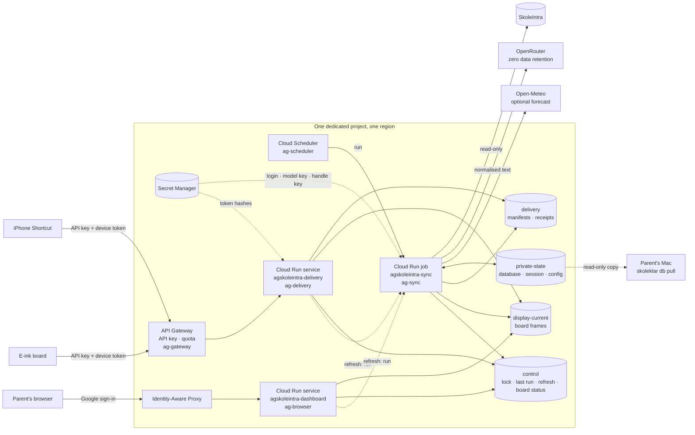

# Google Cloud setup and operations

For builders creating an installation and agents maintaining one. This directory
contains the repeatable Google Cloud foundation for Skoleklar. It uses the
installed Google Cloud CLI and requires the active CLI project to match the
explicit target before it changes anything.

The operator checkout needs `uv sync --all-extras` for login, cloud pulls,
local rendering and provisioning checks. Runtime images install explicit
extras in the Dockerfiles.

## Architecture

The picture of a finished project. [target-state.md](target-state.md) is the
inventory, with a read-only check for each resource. A household that stays
local needs none of it.



**One writer.** Only the scan job reads the school, calls the model and writes
the database. It downloads the database and session from the private-state
bucket, runs every stage and uploads them with a generation match, so a second
writer fails instead of overwriting. A lock object in the control bucket keeps
scans one at a time. The job has no retries: a failed scan leaves the last good
state in place, and the next schedule tries again.

**Two readers.** Neither service can reach the school, the model, the database
or the school login. The delivery service serves the phone's manifest and the
board's frames and accepts receipts and board status; it can create objects in
the delivery bucket but not change or delete them. The browser board serves the
same pre-drawn page as HTML, the board's status and an owner's refresh button.
A refresh from either only asks Cloud Run to start the same job, recorded in
the control bucket under the caller's own request ID.

| Data | Place | Leaves the project to |
| --- | --- | --- |
| School login, model key, message-handle key | Secret Manager, read by `ag-sync` only | the school's login form; OpenRouter |
| Database (no message text), school session, household config | private-state bucket, `ag-sync` only | the parent's Mac, as a read-only copy |
| Phone manifest, receipts | delivery bucket | the registered phone |
| Pre-drawn frames and HTML, up to 36 hours ahead | display bucket; objects are deleted after 2 days | the board; an allowed browser |
| Scan lock, last run summary, refresh requests, board status | control bucket | the browser board's status pages |
| Device token hashes | Secret Manager, read by `ag-delivery` only | nowhere; plaintext tokens stay on the devices and in the Mac's Keychain |

Nothing accepts an unauthenticated request, and each Cloud Run service accepts
only its own front door:

| Way in | For | Checks, in order |
| --- | --- | --- |
| API Gateway | the phone, the board, the Mac's local controller | an API key restricted to this gateway, with a quota of 30 requests a minute; the gateway's identity as the only invoker; then a bearer token compared with a stored SHA-256 hash, and its scopes: `phone`, `display` or `refresh` |
| Identity-Aware Proxy | a parent's browser | Google sign-in and `iap.httpsResourceAccessor`; the IAP agent as the only invoker; then the signed IAP assertion, its audience and issuer, and the owners and viewers from `[gcp]` |

A board's token can fetch frames and post its status, nothing else. Only an
owner in the browser, or a device with the `refresh` scope, can start a scan;
the browser's refresh also needs a matching origin and a CSRF token.

What limits the damage:

- Each identity holds grants on single buckets, secrets, the job or a service.
  The one project-level grant is a custom role with a single permission,
  reading a Cloud Run operation's status.
- All buckets enforce uniform bucket-level access and public access prevention.
  The private-state and delivery buckets keep versions and a seven-day soft delete.
- Secrets are replicated in the one region and reach the job and the delivery
  service from Secret Manager, never from the image or the repository.
- Image builds upload only code (see `.gcloudignore`), and tags are immutable.
- The optional alert emails the owner when more than 30 requests reach the
  delivery service in five minutes.

What the cloud does not protect: whoever holds the gateway key and a device
token can read what that device may read until its registry entry is removed.
The session and database are as safe as the project's IAM, so the project
should hold nothing else and have as few owners as possible.

## Provision production

Authenticate both the CLI and Application Default Credentials, select the
project, and apply the idempotent foundation:

```bash
gcloud auth login
gcloud auth application-default login
gcloud config set project YOUR_PROJECT_ID
gcloud config set run/region europe-west1
./infra/gcp/provision-foundation.sh YOUR_PROJECT_ID europe-west1
```

The script provisions:

- required Google Cloud APIs;
- `agskoleintra`, an immutable-tag Docker repository in Artifact Registry;
- `ag-sync`, `ag-delivery` and `ag-scheduler` service accounts (`deploy-gateway.sh`
  creates `ag-gateway`);
- separate private-state and delivery buckets with public access prevention,
  uniform bucket-level access, versioning, seven-day soft delete, and bounded
  lifecycle cleanup;
- a seven-day, intentionally unlocked retention policy on delivery objects;
- empty Secret Manager containers for school, OpenRouter, opaque message-handle,
  and device credentials;
- bucket- and secret-scoped runtime IAM grants.

The delivery identity can read delivery objects and create new receipts. It
cannot update or delete delivery objects and has no access to the private-state
bucket. The Cloud Run service is private; only the API Gateway identity can
invoke it. The scheduler identity receives no invocation rights until its
concrete Cloud Run job exists.

## Add secret values

Secret values are an operator action and must never be committed or passed as a
command-line argument. Add each value from a private terminal prompt:

```bash
read -r -s AG_SECRET_VALUE
printf %s "${AG_SECRET_VALUE}" | gcloud secrets versions add SECRET_NAME \
  --project=YOUR_PROJECT_ID \
  --data-file=-
unset AG_SECRET_VALUE
```

The deployment helper applies that pattern and skips any secret that already has
an enabled version:

```bash
./infra/gcp/configure-runtime-secrets.sh YOUR_PROJECT_ID
```

To replace an existing OpenRouter value, use the explicit rotation option. The
helper validates the key with OpenRouter before creating the new secret version:

```bash
./infra/gcp/configure-runtime-secrets.sh YOUR_PROJECT_ID --rotate-openrouter
```

The secret names are:

- `agskoleintra-school-username`
- `agskoleintra-school-password`
- `agskoleintra-openrouter-api-key`
- `agskoleintra-message-handle-key`
- `agskoleintra-device-token-hash`

The device value is the server-side hash of a random device bearer token, not
the plaintext token used by the iPhone.
`configure-runtime-secrets.sh` generates the message-handle key locally and
sends it directly to Secret Manager without printing it. Rotating that key
invalidates stored opaque message references, so rotation is an explicit
operator action:

```bash
./infra/gcp/configure-runtime-secrets.sh YOUR_PROJECT_ID --rotate-message-handle-key
```

## Deferred workload resources

Cloud Run Job, Cloud Run delivery service, Scheduler triggers, and runtime
alerts are created with the workload deployment rather than with placeholders.
This ensures that invocation IAM is scoped directly to real workloads and that
a successful-looking schedule cannot run an inert container.

## Local development

A household can run on its own machine instead (the local runtime). Say so in
`skoleklar.toml`, then scan, serve the board on this machine, and schedule the
scans:

```toml
[runtime]
where = "local"
```

```bash
uv run skoleklar scan                      # every stage the cloud job runs
uv run skoleklar serve                     # the browser board at http://localhost:8787/
uv run skoleklar scan-schedule install     # launchd (macOS) or a systemd user timer
```

Start the delivery API against local delivery objects with a SHA-256
device-token hash in `AG_DEVICE_TOKEN_HASH`:

```bash
AG_DELIVERY_ROOT="$HOME/.config/ag-skoleintra/delivery" \
  uv run uvicorn skoleklar.delivery_api:app \
  --host 127.0.0.1 --port 8080 --no-access-log
```

The generic unauthenticated check is `GET /health`. Every `/v1/*` endpoint
requires the bearer token.

## Deployment sequence

The [dashboard timeline](../../docs/dashboard-timeline.md) separates scan
schedules from layout transitions and device wakes. `.gcloudignore`
uploads only the Dockerfiles, `pyproject.toml`, `uv.lock`, `README.md`, `src/` and
the Cloud Build files, so private rendered artifacts never reach Cloud Build.

### Updating the running services

Once everything exists, an update only swaps images, which keeps each service's
environment, secrets, IAM and IAP settings exactly as they are. Build from a
clean checkout of `main`, then update the readers before the job, so they
understand any new `current.json` format before the job writes it:

```bash
./infra/gcp/build-image.sh YOUR_PROJECT_ID europe-west1 main-SHA-DATE
gcloud builds submit . --project=YOUR_PROJECT_ID \
  --config=infra/gcp/cloudbuild-delivery.yaml \
  --substitutions=_IMAGE=europe-west1-docker.pkg.dev/YOUR_PROJECT_ID/agskoleintra/app:delivery-SHA-DATE
gcloud run services update agskoleintra-delivery --region=europe-west1 --image=DELIVERY_IMAGE
gcloud run services update agskoleintra-dashboard --region=europe-west1 --image=APP_IMAGE
gcloud run jobs update agskoleintra-sync --region=europe-west1 --image=APP_IMAGE
```

A new gateway route needs a new API config. Do not run `deploy-gateway.sh` for
that, because it also manages the API key. Render the spec with the delivery
backend URL, then create the config and point the gateway at it:

```bash
sed "s|__BACKEND_URL__|DELIVERY_URL|g" infra/gcp/gateway-openapi.yaml > /tmp/gateway.yaml
gcloud api-gateway api-configs create delivery-NAME-DATE --api=agskoleintra-delivery \
  --openapi-spec=/tmp/gateway.yaml --backend-auth-service-account=ag-gateway@YOUR_PROJECT_ID.iam.gserviceaccount.com
gcloud api-gateway gateways update agskoleintra-delivery --location=europe-west1 \
  --api=agskoleintra-delivery --api-config=delivery-NAME-DATE
```

The delivery service uses `Dockerfile.delivery` without the browser extra;
the job and browser dashboard use the Playwright-capable `Dockerfile`. The deploy scripts below are for first setup or for changing
configuration. `deploy-sync-job.sh` defaults to private messages off; always
choose and pass the installation's mode explicitly.
`deploy-browser.sh` sets the owner and viewer lists from `skoleklar.toml`
(`[gcp] owners` and `viewers`), replacing what the service had. If enabling
IAP needs a step in the Google Cloud console, for example in a project without
an organization, finish it there; never make the service public to work around it.

### First setup

Follow the sequence in the [ag-school-gcp skill](SKILL.md). It runs every
script in a safe order: the message-handle key goes up before the database, the
writer runs once by hand before anything is reachable, and the schedules come
last. The skill's [target state](target-state.md) lists every resource with a
read-only check. Every script refuses to run unless the active gcloud project is
the target.

The scripts read the household's settings from its `skoleklar.toml`
(`uv run skoleklar runtime show --json`), so none holds a household's values:

- the model, the scan times, the timezone (from `school.toml`), and the weather
  place, if any, for `deploy-sync-job.sh` and `create-schedules.sh`;
- the owners and viewers for `deploy-browser.sh`.

Write that file before the first deploy:

```toml
[runtime]
where = "gcp"
scans = ["mon-fri 05:45", "12:30", "19:30"]

[weather]
place = "Byen"
latitude = 55.68
longitude = 12.57

[gcp]
project = "YOUR_PROJECT_ID"
owners = ["parent@example.com"]
```

If a failed deployment must be reset to the verified local baseline, replace
the two remote state objects with generation preconditions. Bucket versioning
keeps the prior generations recoverable:

```bash
./infra/gcp/seed-private-state.sh YOUR_PROJECT_ID --replace
```

`deploy-sync-job.sh` refuses to deploy until the school username, school
password, OpenRouter, and message-handle secret containers each have an enabled
value. It deploys with private messages fully off by default. For an installation that explicitly opts into message event extraction, seed
the restricted database and deploy with the ZDR processor:

```bash
./infra/gcp/seed-private-state.sh YOUR_PROJECT_ID --restricted
./infra/gcp/deploy-sync-job.sh YOUR_PROJECT_ID europe-west1 IMAGE_URL events-only zdr
```

The database is stored at `state/restricted-v1/school-restricted.db` and uses
the shared browser session in `state/auth-state.json`. Legacy message storage is unsupported. The code refuses any database with
message source records; do not upload a legacy `school.db` as the restricted
database.
`create-schedules.sh` reads configured scan times (three by default); each scan pre-draws layout
changes in between (see the [dashboard timeline](../../docs/dashboard-timeline.md)).
It updates existing jobs but leaves a paused job paused; resume one with
`gcloud scheduler jobs resume JOB --location=europe-west1`. Install alerting only when requested and verify it on the target project.

Build the iPhone Shortcut for this project's gateway, using the hostname
`deploy-gateway.sh` printed (see [iPhone setup](../../docs/iphone-refresh-school.md)):

```bash
uv run python -m skoleklar.phone_shortcut --host GATEWAY_HOST
```

When installing the iPhone Shortcut, copy the locally stored plaintext device
token directly to the clipboard without printing it:

```bash
uv run python -m skoleklar.device_token copy
```

Copy the separately restricted API Gateway key in the same way:

```bash
uv run python -m skoleklar.device_token gateway-copy
```

Clear the clipboard after pasting each value into the designated iPhone.
